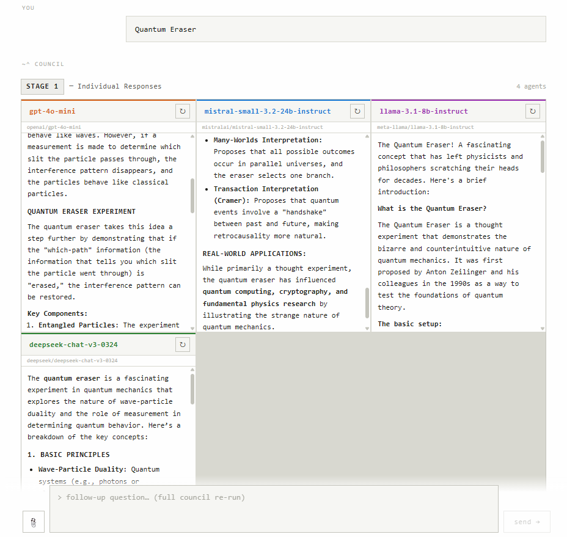
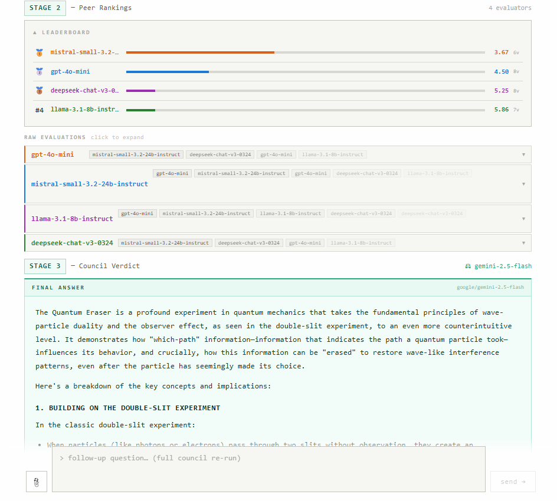
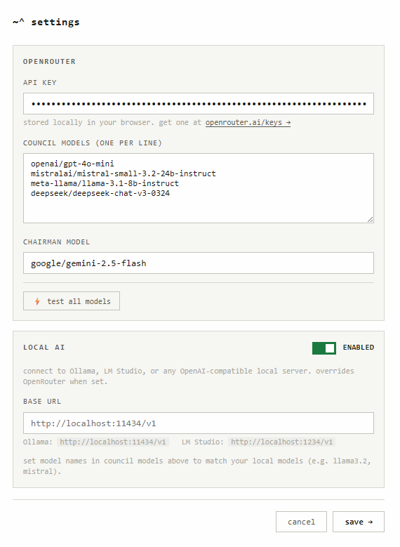
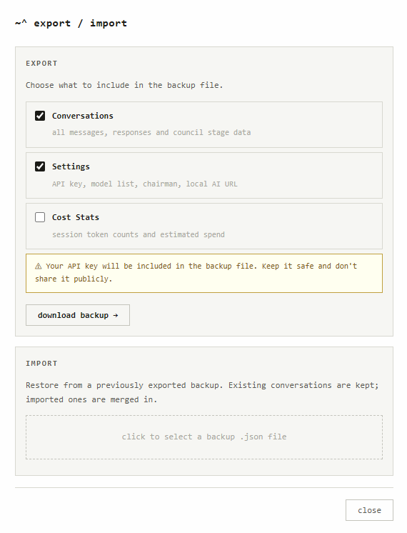
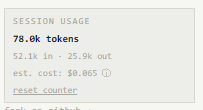
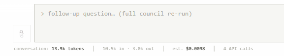

## Try it out

[https://council.jon.io](https://council.jon.io)

# ~^ LLM Council

A multi-model AI deliberation tool that runs entirely in a **single HTML file** — no server, no npm, no build step. Open it in any browser, including on your phone.

**LLM Council** orchestrates a "council" of AI models to answer your questions. It queries multiple LLMs in parallel (Stage 1), asks them to peer-review and rank each other's responses anonymously (Stage 2), then synthesises a final answer using a Chairman model (Stage 3).

---

## How it works

| Stage | What happens |
|-------|-------------|
| **Stage 1** | All council models answer your question in parallel, each in its own colour-coded panel |
| **Stage 2** | Models evaluate each other anonymously and rank the responses — a leaderboard shows the aggregate scores |
| **Stage 3** | The Chairman model synthesises everything into a final verdict |

---

## Screenshots

### Stage 1 — Arena Grid
All model responses side by side. Click a model name to swap it inline; hit ↻ to re-run just that slot.



### Stage 2 — Peer Rankings & Leaderboard
Anonymous peer evaluation with medal rankings, bar charts, and collapsible raw evaluation cards.



### Settings
Configure your OpenRouter API key, council models, chairman model, and optional local AI (Ollama / LM Studio).



### Export / Import
Back up conversations, settings, and cost stats to a JSON file — or restore from one. Works fully offline.



### Token & Cost Tracking
Session total in the sidebar, and a per-conversation usage bar under the input.




---

## Features

- **Zero dependencies at runtime** — React, Babel, and Marked all load from CDN; open the `.html` file directly
- **Arena grid UI** — all model responses visible simultaneously, each colour-coded panel scrolls independently
- **Per-panel redo** — re-run a single model slot without re-running the whole council
- **Inline model swap** — click any model name to change it and re-query on the spot
- **Anonymous peer review** — Stage 2 models never know whose response they're judging
- **File attachments** — drag-and-drop images and PDFs as context for any query
- **Local AI support** — point it at Ollama or LM Studio and it works completely offline
- **Stop button** — abort any in-flight council run instantly
- **Model tester** — one click to ping all configured models and see which respond
- **Print to PDF** — properly rendered markdown, not raw syntax
- **Token & cost tracking** — per-conversation and session-wide, with estimates
- **Export / Import** — backup and restore conversations and settings as a JSON file
- **Mobile responsive** — works on phones with a hamburger sidebar

---

## Setup

**Option 1 — just open it:**

Download [`council.html`](https://github.com/jonromero/llm-council-in-the-browser/blob/master/council.html), open it in any browser. Done.

**Option 2 — visit the hosted version:**

[council.jon.io](https://council.jon.io)

---

## Configuration

1. Click **settings** in the sidebar
2. Enter your [OpenRouter API Key](https://openrouter.ai/keys) (free tier available)
3. Set your **Council Models** — one per line, any model on OpenRouter
4. Set your **Chairman Model** — synthesises the final answer

### Recommended cheap/fast models

```
openai/gpt-4o-mini
mistralai/mistral-small-3.2-24b-instruct
meta-llama/llama-3.1-8b-instruct
deepseek/deepseek-chat-v3-0324
```

### Local AI (Ollama / LM Studio)

Enable the **Local AI** toggle in settings and set the base URL:
- Ollama: `http://localhost:11434/v1`
- LM Studio: `http://localhost:1234/v1`

Then set your council model names to match your local models (e.g. `llama3.2`, `mistral`).

---

## Privacy & Data

- All conversation history and settings are stored in your browser's `localStorage` — nothing leaves your device except the queries sent to OpenRouter (or your local AI)
- Use **Export / Import** to back up or move your data between devices
- Your API key is stored locally and only used to authenticate requests to OpenRouter

---

## Credits

Based on the original [LLM Council](https://github.com/karpathy/llm-council) by [Andrej Karpathy](https://github.com/karpathy).

Client-side single-file edition by [Jon V](https://github.com/jonromero) — built at [lastmachine.com](https://lastmachine.com).

## License

MIT
